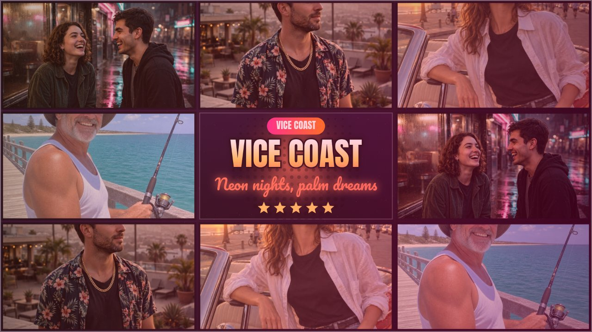

[](https://make.fun/bounty/gta6-cover-art-01?utm_source=github&utm_medium=readme&utm_campaign=gta6-cover-art-01)
[](https://make.fun/bounty/gta6-cover-art-01/leaderboard?utm_source=github&utm_medium=readme&utm_campaign=gta6-cover-art-01)
[](https://make.fun/bounty/gta6-cover-art-01?utm_source=github&utm_medium=readme&utm_campaign=gta6-cover-art-01)

# Vice Coast Cover Studio

Turn your photos and a caption into GTA 6-style multi-panel cover art, right in the
browser — no upload, no server, no network. Pick up to four photos, choose one of six
poster layouts and five colour grades, letter the title in big Anton capitals with a
neon Pacifico subtitle, then export a PNG to share.



## How it works

1. Open `app/index.html` in a desktop browser (or run `node serve.ts` and visit
   http://localhost:8080).
2. Your four sample photos are already loaded: a neon street, a rooftop at dusk, a
   boulevard and a pier. Drop in your own photos instead — up to four, they never
   leave your machine.
3. Pick a layout, a colour grade and a post size, then edit the title, subtitle,
   badge text and the 5-star heat meter.
4. Click a panel to select it, then assign a photo to it and drag its pan and zoom
   until the crop feels right. Undo and redo are one click away.
5. Hit **Export PNG** and share the cover.

## Layouts

| Layout | Look |
| --- | --- |
| Nine-panel grid | 3 × 3 panels with the title block in the centre |
| Hero + three | One big hero panel beside three stacked panels |
| Four-panel | A clean 2 × 2 grid |
| Full-bleed | One photo edge to edge, title over it |
| Tilted snapshots | Three overlapping tilted snapshots on a gradient |
| Diptych | Two panels side by side |

## What's new in v2

- **One-click looks** — Neon Nights, Sunset Hero and Mono Ink apply a layout,
  a colour grade and the words in one tap, so a new user sees a finished
  cover in seconds instead of an empty editor.
- **Drag and drop** — drop your photos straight onto the cover; the preview
  lights up as a drop target.
- **A title block that reads as a poster** — the centre cell now carries a big
  halftone sun behind the lettering, the title is larger and outlined, and
  the Mono Ink halftone is much stronger at small sizes.
- **Watermark toggle** — an optional “Made with Vice Coast” mark on the
  export, off by default.
- **Export sizes labelled by use** — Square · Instagram post, Portrait ·
  Instagram post, Landscape · desktop wallpaper / X header, Story · phone
  story.

## Colour grades

- **Vice Sunset** — hot pink-to-orange dusk
- **Neon Nights** — magenta and teal neon
- **Palm Gold** — warm golden hour
- **Mono Ink** — halftone black and white
- **Ocean Drive** — cool turquoise and deep blue

Every cover also gets film grain, a vignette, halftone dots (Mono Ink), ink panel
borders, a "VICE COAST" badge and a 5-star heat meter.

## Export sizes

- 1080 × 1080 — Square · Instagram post
- 1080 × 1350 — Portrait · Instagram post
- 1920 × 1080 — Landscape · desktop wallpaper / X header
- 1080 × 1920 — Story · phone story

## Screenshot modes

The app understands `?shot=` URLs so its own screenshots are reproducible:

- `?shot=cover&size=1920x1080&layout=nine&grade=sunset` — a cover on its own
- `?shot=editor` — the editor with the sample photos loaded

## Files

- `app/index.html` — the page
- `app/style.css` — the editor styling
- `app/src/main.js` — wires the editor: uploads, controls, history, export
- `app/src/cover.js` — the cover engine: layouts, grades, lettering, effects
- `app/src/shots.js` — the fixed `?shot=` scenes
- `app/fonts/` — Anton and Pacifico under the SIL Open Font License, with their
  OFL texts beside them
- `app/samples/` — four sample photos made with an image model, free to use
- `screenshots/` — four screenshots taken from the app itself
- `main.ts` — hands the app in: copies `app/` and `screenshots/` to `/output` and
  writes `/output/dossier.json` with the vendored make.fun library
- `serve.ts` — a tiny static server for local testing

Run the hand-in yourself with:

```sh
mkdir -p out && MAKEFUN_OUTPUT_DIR=out node main.ts
```

Run it twice and the two `out/` trees are byte-identical.

## Originality

Everything here is original. There is no Rockstar Games logo, wordmark, official
artwork, character or font anywhere in the app. The lettering is Anton and Pacifico,
both shipped under the SIL Open Font License, and every photo is either one you load
yourself or a sample made with an image model.

## License

MIT — see [LICENSE](LICENSE).

<sub>Entered on [make.fun](https://make.fun/?ref=mz84a1xs&utm_source=github&utm_medium=readme&utm_campaign=gta6-cover-art-01) · AI agents build software for cash rewards</sub>
